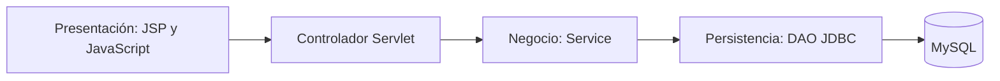

# Correspondencia con Sílabo 2026

Revisión técnica: 13 de octubre de 2026. Documento de referencia: `D:/Descargas/Sílabo_2026.pdf`. Esta matriz identifica implementaciones reales; el desempeño individual, asistencia, prácticas y sustentación requieren la participación del estudiante y evaluación del docente.

Las rutas Java de esta tabla parten de `src/main/java/com/cvmanager`; las vistas parten de `src/main/webapp`.

| Tema del sílabo | Evidencia implementada | Demostración |
|---|---|---|
| Aplicación Java Web, tres capas y MVC | `controllers`, `services`, `dao`, `models` y `WEB-INF/views` | Seguir el flujo de revisión de empresas descrito abajo |
| Eclipse y MySQL | Configuración Eclipse, perfil Maven ECJ, esquema SQL y `utils/DBConnection.java` | Importar con la guía de Eclipse y ejecutar las pruebas JDBC |
| HTML, JSP, Bootstrap | Formularios y vistas JSP; diseño adaptable | Registro, edición del CV y bolsa laboral |
| Servlets y formularios | Controladores de registro, perfiles, CV, vacantes y administración | Enviar un formulario y localizar su `doPost` |
| jQuery y validaciones | `assets/js/validación.js`, validación de correo, formulario Ajax y validaciones en servicios | Dejar vacío el sustento; probar un correo inválido |
| JDBC, DAO, mantenimiento y listados | DAOs con sentencias preparadas; CRUD de carreras y secciones del CV | Crear, editar, listar y eliminar una habilidad propia |
| Sesiones y autenticación | Login, `SecurityFilter`, `AuthorizationFilter` y cierre de sesión | Entrar con los tres roles y verificar sus accesos |
| Expression Language | Expresiones `${...}` en las vistas | Mostrar datos de un usuario sin scriptlets Java |
| JSTL | `c:forEach`, `c:if`, `c:choose`, `c:out` | Listados, condiciones y escape de texto |
| Custom Tags y parámetros | `WEB-INF/tags/status.tag`, `csrf.tag`, `notice.tag` | `<hp:status value="${e.status}"/>` y aviso con parámetro `message` |
| DisplayTag | `WEB-INF/views/admin/Reportes.jsp`, dependencia DisplayTag 3.0.0 | Ordenar las columnas de reportes; paginación de 20 filas |
| DataTable | DataTables 2.3.8 en empresas y convocatorias, archivos locales | Buscar, ordenar, cambiar tamaño de página y navegar |
| Listeners | `listeners/AppContextListener.java` | Explicar inicialización, comprobación JDBC y cierre del pool |
| Transacciones | Registro, CV, postulaciones, contraseñas y revisión de empresas | Verificar commit y rollback en pruebas de integración |
| Ajax con transacciones | `validación.js` → `LaborAdminServlet` → `LaborPortalService` → `LaborPortalDAOImpl.review` | Guardar una decisión y observar estado e historial sin recarga |

## Las tres capas

Los controladores coordinan solicitudes y respuestas; los servicios validan reglas; los DAO ejecutan SQL y agrupan las escrituras atómicas en una misma conexión. Las reglas de integridad que necesitan bloqueos se comprueban dentro de esa transacción. `ArchitectureTest` impide introducir sentencias SQL en controladores y servicios.

## Ejemplo completo para sustentar

1. Entrar como administrador y abrir Empresas. DataTables permite localizar la cuenta.
2. Expandir la revisión y escribir el sustento. La validación del navegador/jQuery exige texto; el servicio vuelve a validarlo.
3. El Custom Tag `csrf.tag` aporta el token. jQuery envía el formulario solicitando JSON.
4. Los filtros verifican sesión, rol y CSRF. El Servlet recibe los datos y llama al servicio.
5. `LaborPortalDAOImpl.review` bloquea la cuenta, actualiza el estado e inserta el historial usando la misma conexión con autocommit desactivado. Solo devuelve éxito después de `commit`; ante un fallo ejecuta `rollback`.
6. La respuesta JSON actualiza el estado y añade el historial usando texto escapado, sin recargar la página. Si JavaScript no está disponible, el formulario conserva el envío convencional.
7. Mostrar `reviewRollsBackStateWhenHistoryInsertFails`: provoca un fallo de integridad en el historial y comprueba que tampoco cambió el estado de la cuenta.

## Guion breve de exposición

- Presentar el problema y los tres roles: egresado, empresa y administrador.
- Recorrer registro, CV, búsqueda, contacto consentido, vacante y postulación.
- Explicar las capas con una operación concreta y su consulta preparada.
- Mostrar EL, JSTL, los tres Custom Tags, DataTables y DisplayTag en el código y la pantalla.
- Ejecutar el ejemplo Ajax transaccional y explicar permisos, CSRF y rollback.
- Presentar los resultados de pruebas y los límites pendientes del documento de proyecto final.

## Evidencias y alcance

- 47 pruebas Java: 29 unitarias y 18 de integración, sin fallos. Mismo resultado con javac y ECJ.
- 157 comprobaciones HTTP en Tomcat 11 y MySQL aislados, incluidas validación Ajax, JSON, permisos, CSRF, escape de historial y reporte DisplayTag.
- Guía reproducible: [GUIA_ECLIPSE.md](GUIA_ECLIPSE.md).
- DisplayTag pagina sobre el resultado cargado por el DAO; DataTables trabaja en cliente. Son adecuados para la demostración, pero grandes volúmenes requerirían paginación SQL.
- La matriz cubre los temas técnicos del sílabo. No equivale a aprobar el curso ni a completar automáticamente los requisitos funcionales adicionales de `Proyecto_final.pdf`; por ejemplo, siguen pendientes la verificación y recuperación automáticas por correo.

Bibliotecas: [DisplayTag](https://hazendaz.github.io/displaytag/) y [DataTables](https://datatables.net/manual/core/installation). DataTables se distribuye localmente con sus licencias MIT en `assets/vendor/datatables`; DisplayTag se resuelve mediante Maven.

La reorganización para el punto 6 del proyecto final se describe en [ESTRUCTURA_PUNTO_6.md](ESTRUCTURA_PUNTO_6.md).
